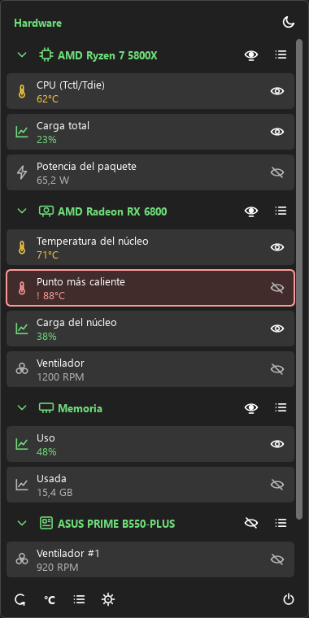
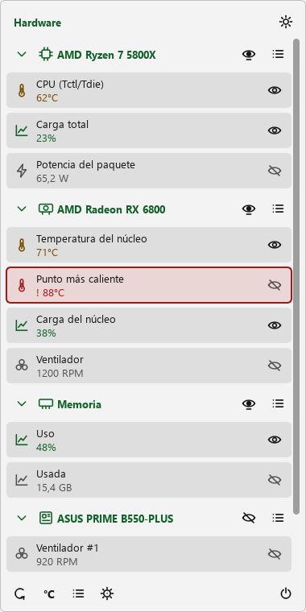
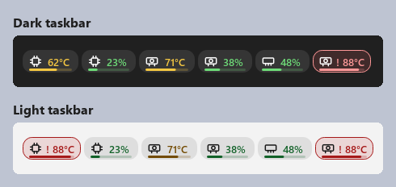
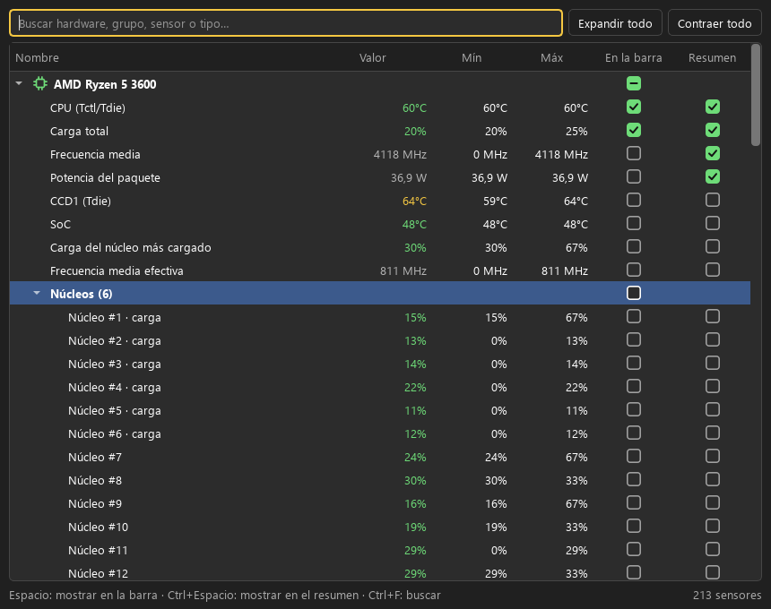

# Hardware Monitor Widget

Widget para la barra de tareas de Windows 11 que muestra temperaturas, cargas, frecuencias, potencia y
ventiladores de tu equipo. Muestra píldoras junto al área de notificación y un panel con tarjetas (tema
claro/oscuro) con el resumen, y una ventana de detalle con todos los sensores. Lee el hardware por sí misma
(LibreHardwareMonitor), sin necesidad de ninguna otra aplicación de monitorización.

## Capturas
| Panel oscuro | Panel claro |
| --- | --- |
|  |  |

| Píldoras en la barra | Ventana de detalle |
| --- | --- |
|  |  |

## Instalación
- **Instalador** (recomendado): ejecuta `HardwareMonitorWidget-Setup-<versión>.exe`. Instala en
  `%ProgramFiles%\HardwareMonitorWidget`, ofrece iniciar con Windows y permite actualizar desde la propia app.
- **Portable**: descomprime `HardwareMonitorWidget-portable-<versión>.zip` en una carpeta que **solo los
  administradores puedan escribir** (la app corre elevada). Las copias portables no se actualizan solas.

Más detalles de compilación y empaquetado en `docs/PACKAGING.md`.

## Permisos y PawnIO
La aplicación pide **administrador** (UAC) al iniciar: es necesario para leer las temperaturas de CPU y placa
base. Para las temperaturas de CPU hace falta además el controlador **PawnIO**, que se instala por separado
desde https://pawnio.eu (el instalador no lo descarga ni lo incluye). Sin administrador o sin PawnIO la app
sigue funcionando, pero faltan esos sensores y se indica en el panel.

## Privacidad
- Todo se ejecuta en local. No hay telemetría ni cuentas.
- La única conexión de red es la comprobación de actualizaciones a GitHub (se puede desactivar en Ajustes) y
  solo se usa si la compilación incluye claves de firma.
- "Acerca de > Copiar info técnica" no incluye nombre de usuario, nombre de equipo ni rutas de perfil.
- Notas de seguridad en `docs/SECURITY_NOTES.md`.

## Desarrollo
Requisitos: Python 3.14 y .NET SDK (para `native/SensorHost`).

    python -m venv .venv
    .venv\Scripts\python.exe -m pip install -r requirements-dev.txt
    .venv\Scripts\python.exe -m pytest -q
    .venv\Scripts\python.exe -m hardware_monitor_widget
    .venv\Scripts\python.exe -m hardware_monitor_widget --no-elevate

Especificación: `docs/spec.md`. Diseño de la fase 2: `docs/phase2-design.md`.
No uses el modo elevado desde una carpeta de desarrollo en un equipo compartido.

## Licencias
Proyecto bajo licencia **MIT** (`LICENSE`). Usa LibreHardwareMonitorLib (MPL-2.0), PySide6 y otras
dependencias; ver `THIRD_PARTY_NOTICES.md`. Parte del código está adaptado de Taskbar Battery Widget (MIT, mismo
autor). PawnIO no se redistribuye.
