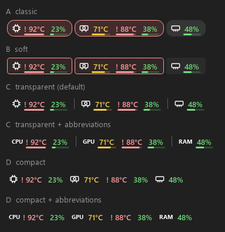
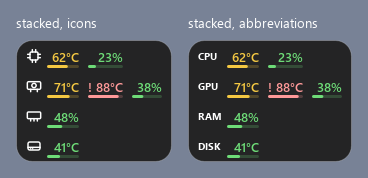
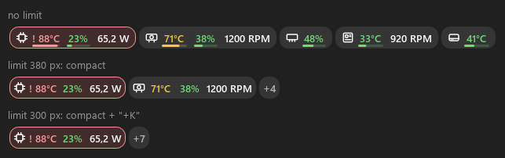
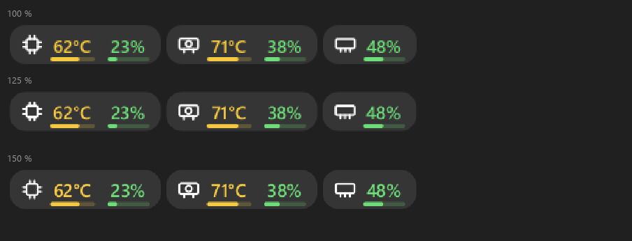
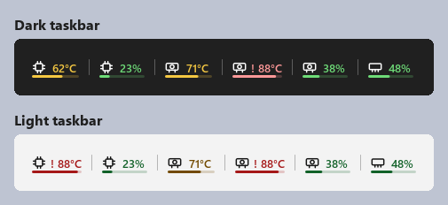

# Hardware Monitor Widget

A Windows 11 taskbar widget that shows your PC's temperatures, loads, fans, clocks, power, memory and disks,
right next to the notification area. It reads the hardware by itself (bundled sensor engine based on
LibreHardwareMonitorLib): no other monitoring app is needed. Spec in `docs/spec.md`.


**[Download the latest release](https://github.com/Gabrielfch/hardware-monitor-widget/releases/latest)**

[](https://paypal.me/GabrielFChiarello)

## Download & install
Get one of these from the [Releases page](https://github.com/Gabrielfch/hardware-monitor-widget/releases/latest):
- `HardwareMonitorWidget-Setup-x.y.z.exe`: installer (recommended). Installs into
  `%ProgramFiles%\HardwareMonitorWidget`, optional start with Windows, can update itself from the app.
- `HardwareMonitorWidget-portable-x.y.z.zip`: no installation. Extract it into a folder that **only
  administrators can write to** (the app runs elevated). Portable copies do not update themselves.

The builds are unsigned, so Windows SmartScreen may warn. Choose **More info -> Run anyway**.

Verify the download against `SHA256SUMS.txt` from the same release:
```powershell
Get-FileHash .\HardwareMonitorWidget-Setup-x.y.z.exe -Algorithm SHA256
```
The hash printed must match the line for that file in `SHA256SUMS.txt`.

## Requirements
- Windows 11 (x64).
- **Administrator rights**: the app asks for UAC when it starts. Reading CPU and motherboard temperatures needs
  them. Installed copies started with Windows use a scheduled task, so there is no UAC prompt at each logon.
- **PawnIO** driver for CPU temperatures, installed separately from [pawnio.eu](https://pawnio.eu). The installer
  neither downloads nor bundles it. Without admin rights or without PawnIO the app keeps working, but those
  sensors are missing and the panel says so.

## Privacy
The app only connects to the internet when you look for updates: manually from *Settings* or through the
optional automatic check (off by default). The only hosts contacted are `api.github.com` and `github.com`
(the project's releases, with downloads served from `githubusercontent.com`). What is sent is a plain HTTPS
request with the User-Agent `HardwareMonitorWidget/<version>`; no hardware data, identifiers or personal
data. Updates are downloaded only after you confirm; `SHA256SUMS.txt` must carry a valid Ed25519 signature from
one of the project's embedded keys and the installer must match its hash before it runs (you confirm a second
time before installing). Everything else runs locally. It stores only:
- Settings: `%APPDATA%\HardwareMonitorWidget\config.json`
- Logs: `%LOCALAPPDATA%\HardwareMonitorWidget\logs\app.log`, rotated at 512 KB x 3
- Sensor history: `%LOCALAPPDATA%\HardwareMonitorWidget\history\` (one file per day). One sample per minute
  (the average of that minute) of the sensors in the summary and the pinned ones: sensor id and value, no
  personal data. Files older than 30 days are deleted and the folder never exceeds 20 MB. It feeds the charts
  of the detail window. Turn it off or delete it in *Settings > Logs*
- Custom icons: `%ProgramData%\HardwareMonitorWidget\icons` (writable by administrators only)

*About > Copy technical info* never includes your user name, computer name or profile paths.

## Safety
The sensor engine (`SensorHost.exe`) only **reads** sensors: it never changes fan curves, clocks, voltages or
any other hardware setting. It uses the PawnIO driver, never the old WinRing0 driver. Because the app runs as
administrator, every folder it loads code or icons from must be writable by administrators only; see
[docs/SECURITY_NOTES.md](docs/SECURITY_NOTES.md).

## Features
- One pill per component (CPU, GPU, RAM…) on the taskbar: one icon (or CPU/GPU/RAM abbreviations) and the
  values you pinned side by side, each with its own colour band and optional mini bar. A critical value turns
  red with a "!". If they don't fit, whole components are hidden behind a "+N" pill. *Group pills by component*
  can be turned off to get one pill per sensor.
- Pill styles: transparent (default, no background, thin separators), classic, soft and compact. When floating,
  pills can be stacked one component per row.
- Your order: drag categories and components in the panel (or Alt+Up/Down, or *Move up*/*Move down*); the pills
  follow that order and pinning or unpinning never reshuffles them.
- Coexists with [Taskbar Battery Widget](https://github.com/Gabrielfch/taskbar-battery-widget): both sit next to
  the notification area without overlapping.
- Panel (left click on the pills or the tray icon) with collapsible categories: Processor, Graphics, Memory
  (RAM and virtual memory), Disks (every disk), Motherboard and Network, each with a toggle that pins or unpins
  all its sensors. It shows a curated summary (temperatures and loads, fans, clocks
  and power, memory and disk read/write) and hides rarely used sensors such as per-core values or GPU 3D engines.
  Min/max show on hover or focus.
- An eye icon per sensor pins it to the taskbar; the eye on a component pins or unpins all its summary sensors at
  once (up to 32 pinned).
- Detail window (*View all*) with every sensor in a searchable tree, with *In taskbar* and *Summary* check boxes.
- Right click on the pills opens the panel, like Taskbar Battery Widget; the tray menu gives quick actions.
- *Settings* (gear button) open inside the panel:
  - *Display*: which hardware and which sensor categories are shown, °C / °F.
  - *Personalization*: theme (automatic, light, dark), colour palettes (classic, colour-blind friendly, pastel,
    high contrast, mono, or your own colours), icon styles (outline, filled, simple, none), custom icons,
    interface scale (90–130 %), panel size, pill grouping and language.
  - *Position*: taskbar right or left, another monitor, floating (draggable), and visible in fullscreen.
  - *Start with Windows*, *Logs* (open the log or its folder, debug level), *Check for updates* and *About*.
- Custom icons per hardware kind, per component or per sensor: PNG, JPG, BMP, ICO, GIF, WebP or SVG, converted
  to PNG on import.
- Stale or failed readings are dimmed instead of shown as live values, and the engine restarts by itself if it
  stops answering.

## Screenshots

All images use made-up readings and are generated by `tools/screenshots.py`.

**Taskbar pills**, grouped by component, on a dark and a light taskbar.


**Pill styles**: classic, soft, transparent and compact, with icons or abbreviations.



**Stacked** when floating: one component per row.



**When space runs out**: compact mode and a "+N" pill for the hidden sensors.



**Sharp at any Windows display scaling**: 100 %, 125 % and 150 %.



**Panel**, dark and light themes.


**Detail window** with every sensor.


**One pill per sensor** (grouping turned off).



## Languages
Available languages: English, Español (Spanish), Português (Portuguese, Brazilian), Français (French),
Русский (Russian), 简体中文 (Simplified Chinese) and 日本語 (Japanese).

Choose one in *Settings ▸ Personalization ▸ Language*. *Automatic* follows the Windows language and falls
back to English when it is not one of the above. Decimal separators follow each language (comma in Spanish,
Portuguese, French and Russian; point in English, Chinese and Japanese).

> Portuguese, French, Russian, Simplified Chinese and Japanese were machine-translated (AI) and may contain
> mistakes; corrections are welcome.

### Request a language
Open a [Translation / language request](https://github.com/Gabrielfch/hardware-monitor-widget/issues/new?template=translation.yml)
issue to ask for a new language or to correct a text.

### Contribute a translation
1. Copy a table from `hardware_monitor_widget/strings_pt.py` (it has every key) to a new `strings_<code>.py` and
   translate every value, keeping the keys and the `{placeholders}` (such as `{name}` or `{n}`) unchanged.
2. Register it in `hardware_monitor_widget/i18n.py` (`LANGUAGES`, `MACHINE_TRANSLATED`, `TRANSLATION_MODULES`
   and the static import) and in `LANGUAGE_CHOICES` in `config.py`. If it uses a decimal comma, add it to
   `DECIMAL_COMMA`.
3. Run `.\.venv\Scripts\python -m pytest -q tests\test_i18n.py` (checks that all keys and placeholders match).
4. Open a pull request, or paste the translated block in an issue using the translation template.

## Run from source
Requires Python 3.14 and the .NET 8 SDK (for `native/SensorHost`).
```powershell
python -m venv .venv
.\.venv\Scripts\python -m pip install -r requirements-dev.txt
.\.venv\Scripts\python -m hardware_monitor_widget
.\.venv\Scripts\python -m hardware_monitor_widget --no-elevate
```
`--no-elevate` skips the UAC prompt (development; CPU temperatures will be missing). Do not use the elevated
mode from a development folder on a shared PC: the folder is writable by other users.

## Tests
```powershell
.\.venv\Scripts\python -m pytest -q
```

## Build
Requires PyInstaller in the venv, the .NET 8 SDK and Inno Setup 6.
```powershell
.\packaging\build.ps1
```
It runs the tests, publishes the self-contained sensor engine, builds the app (onedir) and the installer, and
writes `dist\HardwareMonitorWidget-Setup-<version>.exe`, `dist\HardwareMonitorWidget-portable-<version>.zip` and
`dist\SHA256SUMS.txt`. Details in [docs/PACKAGING.md](docs/PACKAGING.md).

## Limitations
- Windows 11 only. Horizontal taskbars verified on screen; vertical taskbars are covered by unit tests only.
- Which sensors exist depends on your hardware and on LibreHardwareMonitorLib's support for it; some
  motherboards expose few or no fan and temperature sensors.
- CPU temperatures need both administrator rights and the PawnIO driver.
- While a Windows 11 shell flyout is open (Quick Settings, Start, notifications), the widget is hidden until the
  flyout closes.

## Support the project
Hardware Monitor Widget is free and open source. If it is useful to you and you want to support its
development, you can make a donation via [PayPal](https://paypal.me/GabrielFChiarello). Reporting how it works on
your hardware in an [issue](https://github.com/Gabrielfch/hardware-monitor-widget/issues) helps just as much.

## Acknowledgements
- [LibreHardwareMonitor](https://github.com/LibreHardwareMonitor/LibreHardwareMonitor) (MPL-2.0): the sensor
  library used by the bundled engine.
- [PawnIO](https://pawnio.eu): the driver used for low-level sensor access.
- [Taskbar Battery Widget](https://github.com/Gabrielfch/taskbar-battery-widget) (MIT, same author): the base of
  the taskbar pills, the panel and the settings.

## Disclaimer
Not affiliated with, endorsed or sponsored by AMD, Intel, NVIDIA, Microsoft or any hardware vendor. Brand and
product names are used only to indicate compatibility and belong to their respective owners.

## License
[MIT](LICENSE). Bundled third-party components are listed in [THIRD_PARTY_NOTICES.md](THIRD_PARTY_NOTICES.md).
Changes are listed in [CHANGELOG.md](CHANGELOG.md).
